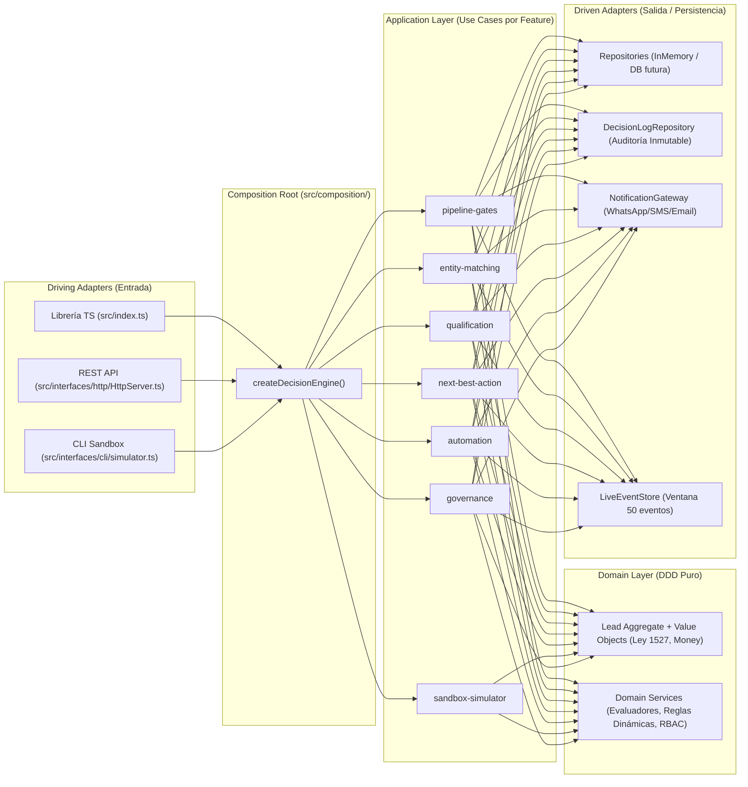
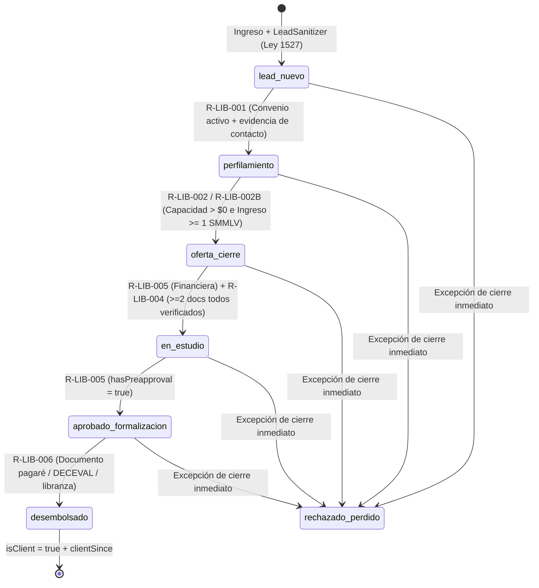
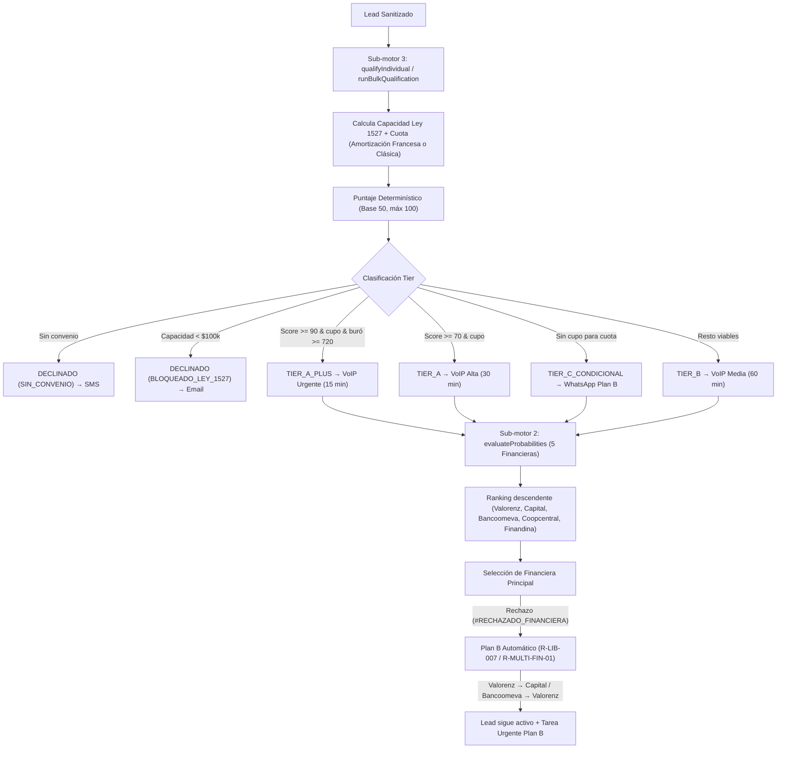
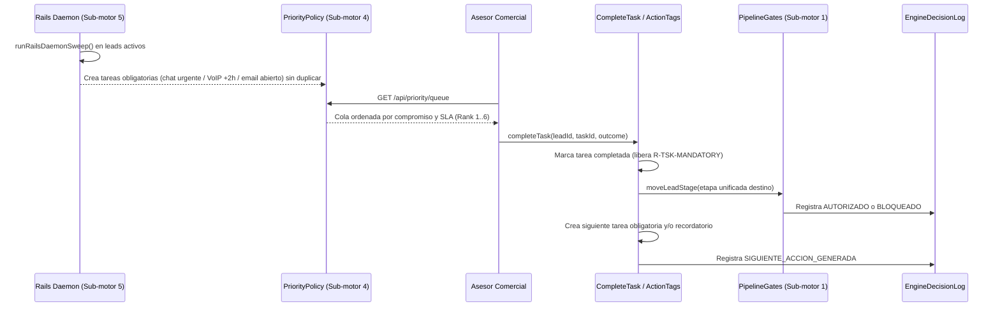
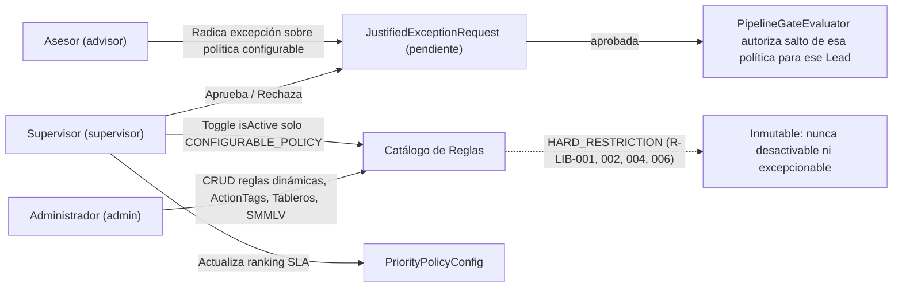

# Flujo de Trabajo del Motor de Decisiones (CrediFlow CRM – Credit Libranzas)

Este documento describe de extremo a extremo el **flujo de trabajo técnico y operativo** del motor de decisiones implementado bajo **Arquitectura Hexagonal basada en Features + DDD**, desde la entrada de un prospecto (`Lead`) hasta su desembolso y transformación automática en **Cliente Activo**.

---

## 1. Flujo Arquitectónico (Entrada → Dominio → Persistencia)

Toda operación entra por un **Driving Adapter** (Librería TS, REST API o CLI Sandbox), atraviesa el **Composition Root** (`createDecisionEngine`), ejecuta un **Caso de Uso** de su feature y delega las reglas puras a **Servicios de Dominio / Agregados**, persistiendo efectos a través de **Driven Ports**.



---

## 2. Flujo de Ciclo de Vida del Prospecto (Pipeline de 7 Etapas)

El tablero estándar (`board-libranzas-principal`) aplica compuertas determinísticas en orden estricto. Ningún asesor puede saltar etapas (`R-SEC-01`) ni mover un lead con tareas obligatorias abiertas (`R-TSK-MANDATORY`).



### Detalle del Flujo por Compuerta

1. **Ingreso y Sanitización (`engine.leads.upsert`)**:
   - Normaliza alias heredados (`primer_contacto` → `perfilamiento`, `cerrado_no_interesado` → `rechazado_perdido`, etc.).
   - Si falta `netIncome`, estima `round(monthlyIncome * 0.88)`.
   - Calcula la capacidad disponible bajo **Ley 1527**:
     $$\text{Capacidad} = \max\big(0,\ (\text{Ingreso Neto} \times 0.50) - \text{Descuentos Previos}\big)$$
2. **Evaluación de Compuertas (`canTransitionStage` / `moveLeadStage`)**:
   - En tablero estándar: valida `Cierre inmediato` → `R-SEC-01` → `R-TSK-MANDATORY` → `R-LIB-001` → compuerta de etapa destino → **reglas dinámicas activas** creadas por `admin` (si una política configurable falla, consulta si existe una **Excepción Justificada aprobada**).
   - En tableros personalizados (`isDefault === false`): valida únicamente `R-TSK-MANDATORY` y reglas dinámicas asociadas.
   - Si es bloqueado: registra `verdict = 'BLOQUEADO'` en `EngineDecisionLog` y devuelve `ruleId` y `missingCondition`.
   - Si es autorizado: actualiza `currentStageId`, anexa nota histórica, activa `isClient = true` si llega a desembolso o última etapa de tablero (> 2 fases), y registra `verdict = 'AUTORIZADO'`.

---

## 3. Flujo de Calificación, Probabilidades Multientidad y Plan B



---

## 4. Flujo Operativo Diario del Asesor (Cola, Tareas, Etiquetas y Daemon)

El trabajo diario del asesor está guiado de forma determinística por tres mecanismos coordinados:



### Prioridad de Atención (`PriorityPolicyConfig`)

| Rank | Tipo de Caso (`caseType`) | SLA | Score Base |
|---|---|---|---|
| 1 | `cita_acordada` | 5 min | 100 |
| 2 | `chat_reciente` | 5 min | 90 |
| 3 | `devolucion_glosa` | 30 min | 80 |
| 4 | `llamada_solicitada` | 60 min | 70 |
| 5 | `lead_nuevo` | 15 min | 60 |
| 6 | `credito_sin_seguimiento_12h` | 120 min | 50 |

*(Si el tiempo transcurrido supera el SLA, el priorizador añade un impulso automático de `+15 pts` y marca `slaBreached = true`.)*

### Etiquetas Operativas (`triggerActionTag`)

- `#NO_CONTESTA`: envía WhatsApp automático, agenda recordatorio en `+2h` e incrementa `cadenceState.retryCount`.
- `#ESTA_OCUPADO`: agenda recordatorio urgente a la hora acordada (por defecto `16:00`) y confirma por WhatsApp.
- `#FALTAN_DOCUMENTOS`: envía WhatsApp solicitando 2 últimos desprendibles y cédula al 150%.
- `#SOLICITA_MENOR_MONTO`: ajusta `requestedAmount` al 75% (o monto explícito) y recalibra capacidad (`* 1.15`).
- `#RECHAZADO_FINANCIERA`: registra rechazo, reasigna `selectedFinanciera` al **Plan B**, crea tarea obligatoria urgente y registra `R-MULTI-FIN-01` **sin mover el lead a rechazado**.
- `#CLIENTE_INTERESADO`: registra nota de interés y, si está en `lead_nuevo`, avanza automáticamente a `perfilamiento`.

---

## 5. Flujo de Gobernanza, RBAC y Excepciones Justificadas



| Acción | `advisor` | `supervisor` | `admin` |
|---|:---:|:---:|:---:|
| Operar leads, completar tareas, disparar etiquetas | Sí | Sí | Sí |
| Radicar `JustifiedExceptionRequest` (solo políticas configurables) | Sí | Sí | Sí |
| Aprobar / rechazar excepciones y `forceOverride` | No | Sí | Sí |
| Activar / desactivar reglas `CONFIGURABLE_POLICY` | No | Sí | Sí |
| Actualizar `PriorityPolicyConfig` | No | Sí | Sí |
| Crear / eliminar reglas dinámicas, etiquetas custom, tableros y SMMLV | No | No | Sí |
| Desactivar o excepcionar `HARD_RESTRICTION` (Ley 1527) | No | No | No |

---

## 6. Flujo del Simulador Sandbox Aislado (Sub-motor 6)

El simulador evalúa `R-LIB-001` a `R-LIB-006` (incluyendo `edad + plazo <= 84` para pensionados) y proyecta la matriz multientidad construyendo un `Lead` virtual efímero en memoria:

- **Cero mutación**: no modifica `LeadRepository`, `DecisionLogRepository` ni `LiveEventStore`.
- **Consumo**:
  - Por librería: `engine.sandbox.simulate.execute(input)`.
  - Por API REST: `POST /api/sandbox/simulate`.
  - Por CLI: `node src/interfaces/cli/simulator.ts --all-presets` o `--interactive`.

---

## 7. Recorrido Práctico de Extremo a Extremo (REST API)

Con el servidor levantado (`PORT=3000 node src/interfaces/http/server.ts`):

1. **Crear / sanitizar un prospecto**:
   ```bash
   curl -X POST http://127.0.0.1:3000/api/leads \
     -H "content-type: application/json" \
     -d '{"id":"LEAD-100","fullName":"Ana María Ruiz","libranzaSegment":"Pensionado","pagaduria":"Colpensiones","convenioCodigo":"CONV-COLP-001","age":63,"monthlyIncome":4500000,"currentDiscounts":300000,"creditScoreSimulated":760,"requestedAmount":30000000}'
   ```
2. **Calificar el prospecto (Sub-motor 3)**:
   ```bash
   curl -X POST http://127.0.0.1:3000/api/qualification/lead/LEAD-100 \
     -H "x-actor-role: advisor" -H "x-actor-name: ana.comercial"
   ```
3. **Consultar matriz de probabilidades multientidad (Sub-motor 2)**:
   ```bash
   curl http://127.0.0.1:3000/api/leads/LEAD-100/entity-probabilities
   ```
4. **Avanzar por el pipeline vía etiqueta `#CLIENTE_INTERESADO` o `move-stage` (Sub-motores 1 y 5)**:
   ```bash
   curl -X POST http://127.0.0.1:3000/api/automation/action-tags/trigger \
     -H "content-type: application/json" -H "x-actor-role: advisor" \
     -d '{"leadId":"LEAD-100","tag":"#CLIENTE_INTERESADO"}'
   ```
5. **Revisar cola priorizada y bitácora inmutable de auditoría**:
   ```bash
   curl http://127.0.0.1:3000/api/priority/queue
   curl "http://127.0.0.1:3000/api/governance/audit-logs?leadId=LEAD-100"
   ```
